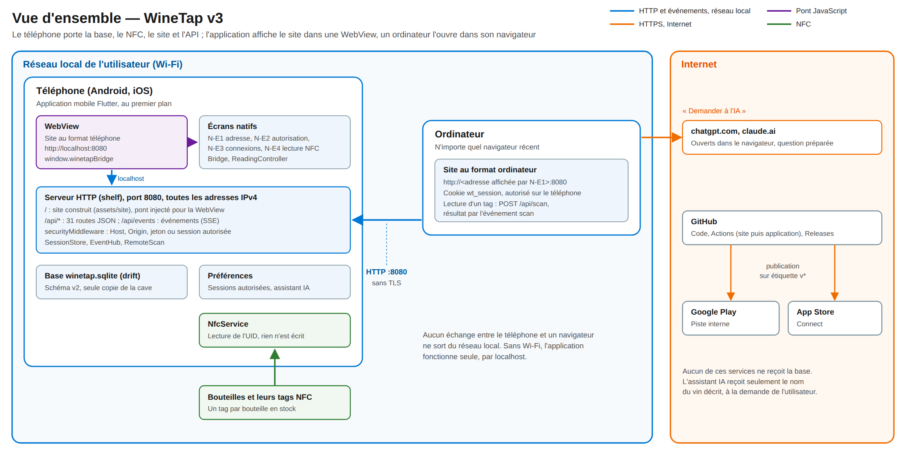

# 3. Vue d'ensemble

<!-- toc -->

**Sur cette page**

- [3.1 Schéma général](#31-schéma-général)
- [3.2 Composants](#32-composants)
  - [3.2.1 Application mobile](#321-application-mobile)
  - [3.2.2 Site web](#322-site-web)
  - [3.2.3 Services externes](#323-services-externes)
- [3.3 Parcours principaux](#33-parcours-principaux)
- [3.4 Choix structurants](#34-choix-structurants)
- [3.5 Fournisseurs et coûts](#35-fournisseurs-et-coûts)

<!-- /toc -->

## 3.1 Schéma général

*Figure 3 — Le téléphone porte la base, lit les tags et sert le site et l'API sur le port 8080.
L'application affiche ce site dans une WebView, par `localhost` ; un ordinateur du même réseau
l'ouvre à l'adresse affichée par le téléphone, une fois autorisé. Seules la chaîne de livraison et
l'aide IA touchent Internet.*

Le système compte une application, un site qu'elle embarque, et aucun serveur.

1. **Le téléphone** exécute l'application mobile. Au démarrage, elle ouvre la base SQLite, démarre
   un serveur HTTP sur le port 8080 de toutes ses adresses IPv4, puis affiche le site dans une
   WebView. Elle garde une session NFC prête à lire un tag.
2. **Le site** est construit à part, puis copié dans les ressources de l'application. Le serveur
   le sert à la racine, et son API sous `/api/`. Dans la WebView, le site prend le format
   téléphone et dispose du pont JavaScript vers le NFC et les fichiers.
3. **Un ordinateur** du même réseau ouvre `http://<adresse du téléphone>:8080`. Le site y prend le
   format ordinateur. Tant que le téléphone n'a pas autorisé ce navigateur, l'API ne lui répond
   pas.
4. **Toute donnée vit sur le téléphone.** Le site ne garde dans le navigateur que le thème choisi
   sur cet appareil : il lit et écrit tout le reste par l'API, et un canal d'événements le prévient
   des modifications faites ailleurs.

Autour, trois services externes, qui ne voient jamais la base : **GitHub** (code, CI, releases),
**Google Play** et **App Store Connect** (distribution de l'application). Le site ouvre aussi
**ChatGPT** ou **Claude** dans un nouvel onglet pour aider à décrire un vin
([§5.7](05-site-web.md#57-aide-à-la-saisie-par-un-assistant-ia)).

## 3.2 Composants

### 3.2.1 Application mobile

| Composant | Rôle | Détail |
|---|---|---|
| `AppShell` (WebView) | Affiche le site, reçoit les appels du pont, superpose les écrans natifs | [§4.2](04-application-mobile.md#42-webview-et-pont) |
| `Bridge` | Côté natif du pont : lecture d'un tag, sauvegarde, choix d'un fichier, écrans natifs, liens externes | [§4.2](04-application-mobile.md#42-webview-et-pont) |
| Écrans natifs N-E1 à N-E4 | Adresse, autorisation d'un navigateur, connexions autorisées, lecture NFC | [§4.3](04-application-mobile.md#43-écrans-natifs) |
| `ReadingController`, `NfcService` | Toute lecture de tag, locale ou demandée par un ordinateur ; une implémentation NFC pour Android, une pour iOS | [§4.4](04-application-mobile.md#44-lecture-nfc) |
| Serveur HTTP (shelf) | Site et API sur le port 8080 | [§4.5](04-application-mobile.md#45-serveur-embarqué-et-cycle-de-vie), [chapitre 7](07-api.md) |
| `securityMiddleware` | Contrôle de l'en-tête `Host`, de l'origine et de l'autorisation sur `/api/` | [§9.3](09-securite.md#93-contrôles-du-serveur) |
| `SessionStore` | Jeton de l'application, demandes d'autorisation, sessions autorisées | [§9.2](09-securite.md#92-autorisation-des-navigateurs) |
| `EventHub` | Canal d'événements `/api/events` | [§7.4](07-api.md#74-événements) |
| `RemoteScan` | Lecture demandée par un ordinateur, une à la fois | [§7.5](07-api.md#75-lecture-demandée-par-un-ordinateur) |
| `DbHolder`, `AppDatabase` (drift) | Base SQLite `winetap.sqlite`, schéma version 2 ; sauvegarde et remplacement à chaud | [chapitre 8](08-donnees.md) |
| Intergiciel `wakelock` | Garde l'écran allumé 5 minutes après chaque requête | [§4.5](04-application-mobile.md#45-serveur-embarqué-et-cycle-de-vie) |
| `ServerLifecycle` | Relance du serveur et de la session NFC au retour au premier plan | [§4.5](04-application-mobile.md#45-serveur-embarqué-et-cycle-de-vie) |

### 3.2.2 Site web

| Composant | Rôle | Détail |
|---|---|---|
| Coque téléphone | Barre d'onglets, écrans E-01 à E-09 au format téléphone | [§5.3](05-site-web.md#53-écrans) |
| Coque ordinateur | Barre latérale, table d'inventaire, panneau de bouteille, raccourcis clavier | [§5.3](05-site-web.md#53-écrans) |
| Session et accès | Attente d'autorisation (E-10), téléphone injoignable (E-11) | [§5.4](05-site-web.md#54-accès-et-connexion-au-téléphone) |
| Magasins d'état | Catalogue, cave, réglages, lecture à distance, rechargés sur événement | [§5.5](05-site-web.md#55-état-et-événements) |
| `lireTag` | Lecture d'un tag : par le pont dans l'application, par `POST /api/scan` sur un ordinateur | [§5.6](05-site-web.md#56-lecture-des-tags) |

### 3.2.3 Services externes

| Service | Rôle | Détail |
|---|---|---|
| GitHub (`psycofdj/WineTap`) | Code, GitHub Actions, Dependabot, Releases | [chapitre 10](10-livraison.md) |
| Google Play | Distribution Android, piste interne | [§10.3](10-livraison.md#103-publication) |
| App Store Connect | Distribution iOS ; la version 2 est en ligne sur l'App Store | [§10.3](10-livraison.md#103-publication) |
| ChatGPT, Claude | Aide à la saisie, ouverte dans le navigateur, à l'initiative de l'utilisateur | [§5.7](05-site-web.md#57-aide-à-la-saisie-par-un-assistant-ia) |

Les versions de tous les composants sont en
[annexe A](14-annexes.md#a-composants-et-versions).

## 3.3 Parcours principaux

| Parcours | Où | Ce qui se passe |
|---|---|---|
| **Consommation** | Application | « Consommer » appelle `readTag('consommer')` sur le pont ; l'écran natif N-E4 lit le tag ; le site envoie `POST /api/consommer`. La bouteille est consommée aussitôt, sans confirmation, et le site propose un commentaire ([§5.6](05-site-web.md#56-lecture-des-tags)). |
| **Identification** | Application | Même lecture, puis `GET /api/bouteilles/tag/<tag>` : la fiche s'affiche, rien n'est modifié. |
| **Entrée en stock** | Application ou ordinateur | Formulaire de bouteille ; le tag est lu par le pont dans l'application, ou par une lecture à distance depuis un ordinateur : `POST /api/scan`, N-E4 sur le téléphone, résultat par l'événement `scan` ([§7.5](07-api.md#75-lecture-demandée-par-un-ordinateur)). La bouteille est créée par `POST /api/bouteilles`. |
| **Consommation depuis un ordinateur** | Ordinateur | Bouton de l'inventaire, sans lecture de tag : `POST /api/bouteilles/<id>/consommer`. |
| **Connexion d'un ordinateur** | Ordinateur, puis téléphone | Le navigateur demande l'accès (`POST /api/session`) ; le téléphone affiche N-E2 ; « Autoriser » ouvre le site au navigateur, qui reçoit l'événement `session` ([§9.2](09-securite.md#92-autorisation-des-navigateurs)). |
| **Catalogue, inventaire, tableau de bord, dégustations** | Application ou ordinateur | Lecture et écriture par l'API ; chaque modification émet l'événement `donnees`, qui fait recharger les autres navigateurs ouverts. |
| **Sauvegarde et restauration** | Application ou ordinateur | `GET /api/sauvegarde` ; restauration en deux temps, examen puis remplacement à chaud de la base ([§11.4](11-exploitation-continuite.md#114-sauvegarde-et-restauration)). |

## 3.4 Choix structurants

Le tableau résume les choix qui donnent sa forme au système. Leur justification est au
[chapitre 12](12-decisions-architecture.md).

| # | Choix | Mise en œuvre | Décision |
|---|---|---|---|
| 1 | Le téléphone est le serveur | Base, NFC, site et API dans l'application mobile | [D-01](12-decisions-architecture.md#d-01--le-téléphone-est-le-serveur) |
| 2 | Un site embarqué pour le téléphone et l'ordinateur | Svelte 5, construit par Vite, servi par le téléphone, affiché par la WebView ; plus de manager de bureau | [D-17](12-decisions-architecture.md#d-17--un-site-embarqué-pour-le-téléphone-et-lordinateur) |
| 3 | Une API JSON dessinée pour le site | Routes `/api/*` en français, erreurs `{erreur, message}` | [D-02](12-decisions-architecture.md#d-02--une-api-http-en-json-dessinée-pour-le-site) |
| 4 | Une seule base, sans synchronisation | Toute écriture passe par l'API du téléphone | [D-03](12-decisions-architecture.md#d-03--une-seule-base-sur-le-téléphone-sans-synchronisation) |
| 5 | Autorisation des navigateurs sur le téléphone, sans HTTPS | Écran de confirmation, sessions sans expiration, révocables ; HTTP en clair | [D-18](12-decisions-architecture.md#d-18--autorisation-des-navigateurs-sur-le-téléphone), [D-04](12-decisions-architecture.md#d-04--pas-de-chiffrement-sur-le-réseau-local) |
| 6 | Adresse affichée par le téléphone | Plus de mDNS : écran N-E1 | [D-05](12-decisions-architecture.md#d-05--adresse-affichée-par-le-téléphone) |
| 7 | Événements poussés par le serveur | *Server-Sent Events* sur `/api/events` : données, lecture à distance, sessions | [D-06](12-decisions-architecture.md#d-06--événements-poussés-par-le-serveur) |
| 8 | Un seul écran natif pour toute lecture de tag | N-E4, ouvert par le pont ou par une lecture à distance | [D-19](12-decisions-architecture.md#d-19--un-seul-écran-natif-pour-toute-lecture-de-tag) |
| 9 | Application au premier plan | Serveur relancé au retour au premier plan ; écran gardé allumé pendant l'activité | [D-07](12-decisions-architecture.md#d-07--application-au-premier-plan-écran-maintenu-allumé-pendant-lactivité), [D-08](12-decisions-architecture.md#d-08--relance-du-serveur-au-retour-au-premier-plan) |
| 10 | Le tag est une association temporaire | Tag libéré à la consommation, réutilisable | [D-09](12-decisions-architecture.md#d-09--le-tag-est-une-association-temporaire) |
| 11 | Consommer d'un geste | Lecture du tag = consommation, sans confirmation | [D-10](12-decisions-architecture.md#d-10--consommation-sans-confirmation) |
| 12 | Sauvegarde par copie du fichier, restauration à chaud | Fichier SQLite complet ; fichier examiné avant remplacement ; base rouverte sans redémarrer | [D-11](12-decisions-architecture.md#d-11--sauvegarde-par-copie-brute-du-fichier-sqlite) |
| 13 | Schéma inchangé, état de la v3 hors de la base | Sessions et réglages dans les préférences de l'application | [D-21](12-decisions-architecture.md#d-21--schéma-inchangé-état-de-la-v3-hors-de-la-base) |
| 14 | Publication entièrement automatisée | Une étiquette `v*` construit le site et publie l'application sur les deux magasins | [D-15](12-decisions-architecture.md#d-15--publication-sur-étiquette-par-github-actions) |

## 3.5 Fournisseurs et coûts

| Fournisseur | Ce qu'il fournit | Coût |
|---|---|---|
| **Apple** | Programme Apple Developer, équipe `H7P23LWU5F` : signature, App Store Connect ; nécessaire pour lire le NFC sur iOS | Abonnement annuel du programme (99 USD par an au tarif public) |
| **Google** | Compte développeur Google Play, application `com.winetap.mobile` | Frais d'inscription payés une fois (25 USD au tarif public) |
| **GitHub** | Dépôt public, Actions (exécuteurs Linux et macOS), Releases, Dependabot | Aucun : Actions est gratuit pour un dépôt public, exécuteurs macOS compris |
| **OpenAI, Anthropic** | Assistants ouverts dans le navigateur | Aucun pour le projet : l'utilisateur se sert de son propre compte, ou de l'accès sans compte |

Aucune infrastructure n'est louée et aucune licence n'est payée : Flutter, Svelte, Vite et toutes
les bibliothèques sont libres ; les polices (Newsreader, IBM Plex) sont sous licence SIL Open Font
License. Le code de WineTap est publié sous GPL v3 (fichier `LICENSE`).
