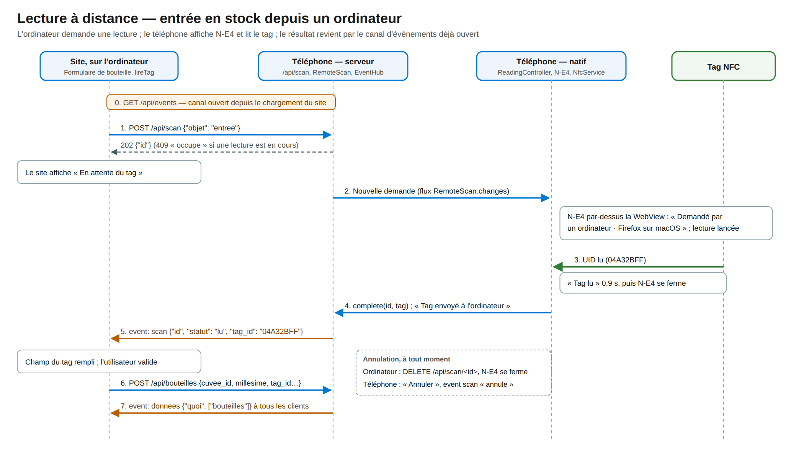

# 7. API et lecture à distance

<!-- toc -->

**Sur cette page**

- [7.1 Conventions](#71-conventions)
- [7.2 Authentification](#72-authentification)
- [7.3 Routes](#73-routes)
- [7.4 Événements](#74-événements)
- [7.5 Lecture demandée par un ordinateur](#75-lecture-demandée-par-un-ordinateur)

<!-- /toc -->

L'API est le seul chemin vers les données, pour la WebView comme pour un ordinateur. Elle a été
dessinée pour le site de la v3 et ne garde pas la compatibilité avec le manager de la v2. Son
contrat est écrit dans `web/API.md` ; le serveur Dart et le serveur simulé du site l'implémentent
chacun.

## 7.1 Conventions

| Élément | Règle |
|---|---|
| Préfixe | Toutes les routes sont sous `/api/` ; le reste des chemins sert le site |
| Format | JSON, champs en `snake_case` et en français (`millesime`, `a_boire_avant`, `consommee_le`) |
| Noms | Ressources en français (`/api/appellations`, `/api/bouteilles`), identifiants numériques |
| Correspondance avec la base | Les champs sont ceux des tables, renommés : `millesime` pour `vintage`, `commentaire` pour `description`, `prix` pour `purchase_price`, `a_boire_avant` pour `drink_before`, `entree_le` pour `added_at`, `consommee_le` pour `consumed_at`, `appellation_id` pour `designation_id` |
| Erreurs | Corps `{"erreur": "<code>", "message": "<texte en français>"}`, parfois avec des précisions (`nombre`, `bouteille_id`, `bouteille`) |
| Taille des corps | 32 Mo pour un corps JSON, 100 Mo pour un fichier de restauration (413 au-delà) |
| Erreur interne | 500, code `interne`, message générique ; le détail ne part que dans le journal du téléphone |

## 7.2 Authentification

| Appelant | Moyen | Obtention |
|---|---|---|
| WebView de l'application | Cookie `wt_app` (`HttpOnly`, `SameSite=Strict`) ; en-tête `X-WineTap-Token` ; paramètre `?token=` pour `GET /api/events` et pour les images, qui ne portent pas d'en-tête | `/?jeton=<jeton>` pose le cookie et redirige vers `/` ; le jeton est aussi injecté dans le pont |
| Navigateur d'un ordinateur | Cookie `wt_session` (`HttpOnly`, `SameSite=Strict`, durée de dix ans) | Posé par `POST /api/session` ; valable une fois la session autorisée sur le téléphone |

Sans identité autorisée, seules `GET /api/session`, `POST /api/session` et `GET /api/events`
répondent ; les autres routes rendent 401 `non_autorise`. Le détail des contrôles est au
[§9.3](09-securite.md#93-contrôles-du-serveur).

## 7.3 Routes

Le serveur monte **31 routes** :

| Domaine | Routes | Remarques |
|---|---|---|
| Session | `GET /api/session`, `POST /api/session` | `GET` rend 200 avec le nom et l'adresse du téléphone, l'année courante et le nombre de connexions autorisées ; 401 avec l'état (`inconnue`, `en_attente`, `refusee`) et la description du client sinon. `POST` demande une autorisation et rend 202, ou 429 `trop_de_demandes` quand le téléphone limite les demandes ([§9.2](09-securite.md#92-autorisation-des-navigateurs)) |
| Événements | `GET /api/events` | Flux *Server-Sent Events* ([§7.4](#74-événements)) |
| Appellations | `GET`, `POST /api/appellations` ; `PUT`, `DELETE /api/appellations/:id` ; `GET /api/appellations/:id/image` | La liste cache l'appellation sentinelle `id = 0` ; l'image arrive en base64 à l'écriture et repart brute, avec son type |
| Domaines | `GET`, `POST /api/domaines` ; `PUT`, `DELETE /api/domaines/:id` | |
| Cuvées | `GET`, `POST /api/cuvees` ; `PUT`, `DELETE /api/cuvees/:id` | Suppression refusée si une bouteille, même consommée, l'utilise |
| Bouteilles | `GET`, `POST /api/bouteilles` ; `PUT`, `DELETE /api/bouteilles/:id` | `GET` rend les bouteilles en stock, et aussi les consommées avec `?consommees=1`. `PUT` ne modifie que les champs présents ; `tag_id: null` retire le tag |
| Consommation | `POST /api/consommer` (par tag) ; `POST /api/bouteilles/:id/consommer` (sans tag) | 404 `tag_inconnu`, 409 `deja_consommee` avec la bouteille |
| Recherche par tag | `GET /api/bouteilles/tag/:tag` | Bouteille en stock portant ce tag ; mêmes erreurs |
| Dégustations | `GET /api/degustations?depuis=&nombre=` | `{total, bouteilles}`, consommées de la plus récente à la plus ancienne |
| Réglages | `GET`, `PUT /api/reglages` | `{assistant: "claude" \| "chatgpt"}`, rangé hors de la base |
| Lecture à distance | `POST /api/scan` ; `DELETE /api/scan/:id` | [§7.5](#75-lecture-demandée-par-un-ordinateur) |
| Sauvegarde | `GET /api/sauvegarde` ; `POST /api/restauration/examen` ; `POST /api/restauration` | [§11.4](11-exploitation-continuite.md#114-sauvegarde-et-restauration) |

Règles communes :

- **Millésime.** Obligatoire à la création, entre 1900 et l'année courante du téléphone.
- **Tag.** Tout identifiant reçu est normalisé ([§8.3](08-donnees.md#83-identifiants-de-tag)).
  Créer une bouteille avec un tag déjà porté par une bouteille en stock rend 409 `tag_utilise`,
  avec l'identifiant de cette bouteille.
- **Références.** Supprimer une appellation, un domaine ou une cuvée encore utilisés rend 409
  `referencee`, avec le nombre d'objets qui l'utilisent.
- **Déjà consommée.** Le tag étant effacé à la consommation, la base ne sait plus quelle bouteille
  il portait. Le serveur garde en mémoire, depuis son démarrage, l'association entre chaque tag
  libéré et sa bouteille, pour répondre `deja_consommee` plutôt que `tag_inconnu` ; il l'oublie dès
  que le tag est associé à une autre bouteille, et à chaque restauration.

## 7.4 Événements

`GET /api/events` ouvre un flux *Server-Sent Events*. Le serveur envoie d'abord `retry: 5000`,
puis un commentaire de maintien toutes les 20 secondes.

| Événement | Données | Quand | Destinataires |
|---|---|---|---|
| `donnees` | `{quoi: ["bouteilles", "catalogue", "reglages"]}` | Après toute modification, d'où qu'elle vienne | WebView et navigateurs autorisés |
| `scan` | `{id, statut: "lu" \| "annule" \| "erreur", tag_id?}` | Fin d'une lecture à distance | WebView et navigateurs autorisés |
| `session` | `{statut: "autorisee" \| "refusee" \| "revoquee"}` | Décision sur le téléphone, révocation | Le navigateur concerné seulement |

Le contrat prévoit un statut `erreur` pour `scan`, que le serveur n'émet pas : une erreur de
lecture se règle sur N-E4, par « Réessayer » ou « Annuler ». Un navigateur non autorisé ne reçoit
que l'événement `session` qui le concerne. Une révocation
ferme ses flux. Tous les flux sont fermés à chaque relance du serveur
([§4.5.2](04-application-mobile.md#452-premier-plan-seulement)).

## 7.5 Lecture demandée par un ordinateur

*Figure 7 — L'ordinateur demande une lecture ; le téléphone affiche N-E4 et lit le tag ; le
résultat revient par le canal d'événements, déjà ouvert.*

1. Le site, sur l'ordinateur, envoie `POST /api/scan` avec l'objet de la lecture (`entree` ou
   `recherche`). Le serveur crée la demande, rend 202 avec son identifiant, ou 409 `occupe` si une
   lecture est déjà en cours.
2. Le `ReadingController` du téléphone affiche N-E4, avec l'origine « Demandé par un ordinateur »
   et le navigateur, et lance la lecture NFC. Si une lecture locale est déjà affichée, la demande
   est aussitôt annulée.
3. L'utilisateur présente le tag. Le téléphone affiche « Tag lu », ferme N-E4, et le serveur émet
   l'événement `scan` avec le statut `lu` et le tag. Le téléphone confirme « Tag envoyé à
   l'ordinateur ».
4. L'ordinateur peut annuler à tout moment par `DELETE /api/scan/<id>` : N-E4 se ferme. Une
   annulation sur le téléphone émet `scan` avec le statut `annule`.

Une seule demande existe à la fois, en mémoire. Elle n'a pas de délai d'expiration : elle reste
ouverte jusqu'au tag lu ou à une annulation, de l'un ou l'autre côté.
