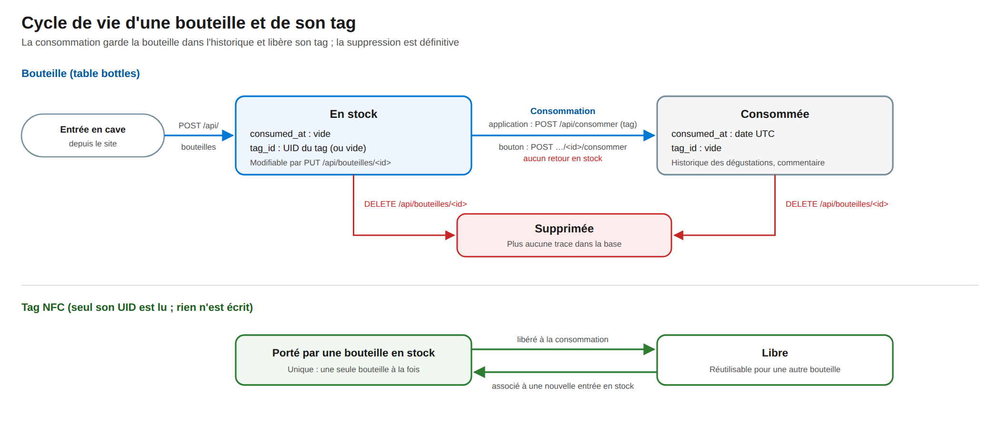

# 8. Données

<!-- toc -->

**Sur cette page**

- [8.1 Modèle](#81-modèle)
- [8.2 Cycle de vie d'une bouteille](#82-cycle-de-vie-dune-bouteille)
- [8.3 Identifiants de tag](#83-identifiants-de-tag)
- [8.4 Stockage](#84-stockage)
- [8.5 Données hors de la base](#85-données-hors-de-la-base)
- [8.6 Sauvegardes](#86-sauvegardes)
- [8.7 Données de référence et jeux d'essai](#87-données-de-référence-et-jeux-dessai)
- [8.8 Données personnelles](#88-données-personnelles)

<!-- /toc -->

## 8.1 Modèle

La base est une base SQLite gérée par `drift`, **schéma version 2**. Elle compte quatre tables :

| Table | Contenu | Champs | Contraintes |
|---|---|---|---|
| `designations` | Appellations | `id`, `name`, `region`, `description`, `picture` (image, facultative) | `name` unique |
| `domains` | Domaines | `id`, `name`, `description` | `name` unique |
| `cuvees` | Cuvées | `id`, `name`, `domain_id`, `designation_id`, `color`, `description` | `domain_id` vers `domains` ; `designation_id` vers `designations`, 0 par défaut |
| `bottles` | Bouteilles | `id`, `tag_id`, `cuvee_id`, `vintage`, `description`, `purchase_price`, `drink_before`, `added_at`, `consumed_at` | `tag_id` unique ; `cuvee_id` vers `cuvees` |

Une bouteille appartient à une cuvée ; une cuvée appartient à un domaine et à une appellation.

Précisions :

- **Appellation sentinelle.** Une base neuve contient l'appellation `id = 0`,
  « (unassigned) », pour les cuvées sans appellation. Les listes de l'API la cachent.
- **Clés étrangères.** Elles sont activées à chaque ouverture de la base
  (`PRAGMA foreign_keys = ON`) : un domaine, une appellation ou une cuvée encore référencés ne
  peuvent pas être supprimés.
- **Unicité du tag.** Elle porte sur toutes les bouteilles ; les bouteilles consommées n'ayant plus
  de tag, elle revient à « un tag ne porte qu'une bouteille en stock ».
- **Valeurs.** `vintage` et `drink_before` sont des années ; `purchase_price` est un nombre réel,
  sans unité enregistrée (les jeux d'essai l'emploient en euros) ; `added_at` et `consumed_at` sont
  des dates UTC au format ISO 8601, posées par le téléphone.
- **Migrations.** `drift` applique les migrations à l'ouverture. La seule migration existante
  (version 1 vers 2) ajoute la colonne `picture` aux appellations.

## 8.2 Cycle de vie d'une bouteille

*Figure 8 — Une bouteille entre en stock avec un tag ; sa consommation pose la date et libère le
tag, qui peut servir à une autre bouteille. La suppression est réservée aux erreurs de saisie et
aux tags perdus.*

| État | `consumed_at` | `tag_id` | Comment on y entre |
|---|---|---|---|
| **En stock** | vide | renseigné (ou vide, si la bouteille a été saisie sans tag) | `POST /api/bouteilles`, depuis l'application ou un ordinateur |
| **Consommée** | date UTC | vide | `POST /api/consommer` (lecture du tag dans l'application) ou `POST /api/bouteilles/<id>/consommer` (bouton, sans tag) |
| **Supprimée** | — | — | `DELETE /api/bouteilles/<id>` |

La consommation est une **suppression logique** : la bouteille reste dans la base et alimente
l'historique des dégustations. Elle se fait en une transaction : recherche de la bouteille en stock
portant le tag, puis écriture de la date et effacement du tag. Aucune route ni aucun écran ne
ramène une bouteille consommée en stock. Le serveur retient en mémoire le tag libéré et sa
bouteille, pour signaler « déjà consommée » à une nouvelle lecture de ce tag
([§7.3](07-api.md#73-routes)).

## 8.3 Identifiants de tag

L'identifiant enregistré est l'**UID matériel** du tag, en hexadécimal majuscule sans séparateur.
Il est produit sous cette forme par la lecture NFC, et le serveur normalise de nouveau tout
identifiant reçu par l'API, d'où qu'il vienne (retrait de `:`, des espaces et de `-`, passage en majuscules) : un
identifiant saisi à la main sous la forme `04:a3:2b:ff` est enregistré `04A32BFF`.

Le tag n'identifie pas un vin : c'est une **association temporaire** entre un objet physique et une
bouteille en stock ([D-09](12-decisions-architecture.md#d-09--le-tag-est-une-association-temporaire)).
Rien n'est écrit sur le tag.

## 8.4 Stockage

| Élément | Emplacement |
|---|---|
| Base | Fichier `winetap.sqlite`, dans le dossier des documents de l'application (bac à sable de l'application) |
| Journal SQLite | Fichiers `winetap.sqlite-wal` et `winetap.sqlite-shm`, à côté |
| Fichiers temporaires de la restauration | `winetap.sqlite.tmp` et `winetap.sqlite.bak`, à côté, supprimés à la fin ; copie d'examen dans le dossier temporaire du système, supprimée aussitôt |

La base n'est **pas chiffrée par l'application**. Elle bénéficie du chiffrement du stockage du
téléphone, actif par défaut sur les versions récentes d'Android et d'iOS, et du cloisonnement des
applications : aucune autre application ne peut la lire.

Le site ne stocke rien dans les navigateurs ([§5.5](05-site-web.md#55-état-et-événements)).

## 8.5 Données hors de la base

La v3 garde le schéma de la v2 ([D-21](12-decisions-architecture.md#d-21--schéma-inchangé-état-de-la-v3-hors-de-la-base)).
Ce qu'elle ajoute est rangé dans les **préférences de l'application** (`shared_preferences` :
`SharedPreferences` sur Android, `NSUserDefaults` sur iOS) :

| Clé | Contenu |
|---|---|
| `v3.sessions` | Sessions autorisées : empreinte SHA-256 de l'identifiant de session, navigateur, système, dernière adresse IP, date d'autorisation, dernière activité. L'identifiant lui-même n'est pas gardé |
| `v3.assistant` | Assistant IA choisi : `claude` (par défaut) ou `chatgpt` |

Ne sont gardés **qu'en mémoire**, et perdus à l'arrêt du processus : le jeton d'application, les
demandes d'autorisation en attente ou refusées, la lecture à distance en cours et les tags libérés
depuis le démarrage.

Ces données ne font pas partie de la sauvegarde WineTap : restaurer une base ne change ni les
sessions autorisées ni le réglage de l'assistant.

## 8.6 Sauvegardes

Trois mécanismes peuvent copier la base hors du téléphone :

| Mécanisme | Déclenchement | Contenu | Détail |
|---|---|---|---|
| Sauvegarde WineTap | Manuel, depuis les réglages du site, dans l'application ou sur un ordinateur | Le fichier SQLite complet, journal intégré au préalable | [§11.4](11-exploitation-continuite.md#114-sauvegarde-et-restauration) |
| Sauvegarde du système Android | Automatique, selon les réglages du téléphone (compte Google) | Les fichiers et les préférences de l'application ; l'application l'autorise (`allowBackup`) et déclare des exclusions pour les fichiers temporaires de SQLite | Règles `backup_rules.xml` (Android 11 et avant) et `data_extraction_rules.xml` (Android 12 et après) |
| Sauvegarde du système iOS | Automatique, selon les réglages du téléphone (iCloud ou ordinateur) | Le dossier des documents de l'application, qui contient la base, et ses préférences | Comportement par défaut d'iOS, sans réglage propre à WineTap |

## 8.7 Données de référence et jeux d'essai

| Jeu | Contenu | Quand il est chargé |
|---|---|---|
| Catalogue de référence | 320 appellations françaises avec leur région (liste SIQO de l'INAO) et 128 domaines | À la **création** de la base, une seule fois ; jamais mis à jour ensuite |
| Jeu d'essai de développement | Une vingtaine de cuvées et 62 bouteilles, dont une partie consommées, à dates fixes | Au démarrage, si la version de l'application contient `0.0.0` et que la table `bottles` est vide |
| Cave simulée du site | Environ 180 bouteilles, en mémoire | Par le serveur de développement du site seulement ([§5.8](05-site-web.md#58-développement)) ; jamais dans l'application |

La version dans le dépôt est `0.0.0+dev` : toute construction qui ne fixe pas de version (lancement
par `flutter run`, mais aussi `scripts/build_packages.sh`, qui produit `0.0.0-<commit>-dev`, bien
qu'il ne serve pas à publier) charge le jeu d'essai sur une base vide. Les publications par la CI fixent la version depuis l'étiquette et
ne le chargent pas.

## 8.8 Données personnelles

La base ne contient **aucune donnée qui identifie une personne** : ni compte, ni nom, ni adresse, ni
localisation. Les commentaires de dégustation sont du texte libre saisi par l'utilisateur.

Les préférences gardent, pour chaque navigateur autorisé, son nom, son système, sa dernière
adresse IP sur le réseau local et ses dates d'autorisation et d'activité
([§8.5](#85-données-hors-de-la-base)). Ces informations restent sur le téléphone.

L'application ne transmet rien à un tiers ([§6.4](06-reseau-flux.md#64-matrice-de-flux)) ; seul le
geste « Demander à l'IA » envoie le nom d'un vin à l'assistant choisi.
