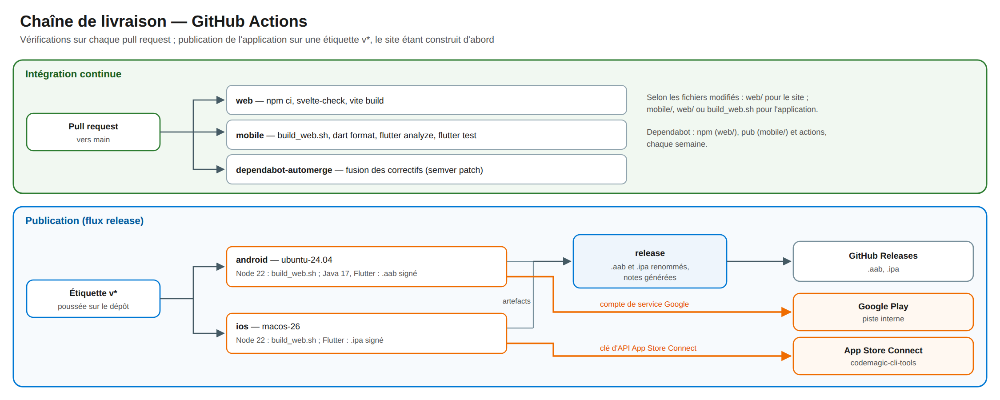

# 10. Livraison et distribution

<!-- toc -->

**Sur cette page**

- [10.1 Dépôt](#101-dépôt)
- [10.2 Intégration continue](#102-intégration-continue)
- [10.3 Publication](#103-publication)
- [10.4 Signature et secrets](#104-signature-et-secrets)
- [10.5 Versions](#105-versions)

<!-- /toc -->

## 10.1 Dépôt

Tout le projet tient dans un seul dépôt GitHub **public**, `psycofdj/WineTap`, branche principale
`main` :

| Dossier | Contenu |
|---|---|
| `mobile/` | Application Flutter, avec ses projets Android (Kotlin, Gradle) et iOS (Swift, Xcode) |
| `web/` | Site : sources Svelte, serveur simulé, contrat d'API (`API.md`) ; `package-lock.json` fixe les versions, `.nvmrc` celle de Node |
| `.github/workflows/` | Quatre flux GitHub Actions |
| `.github/dependabot.yml` | Mises à jour automatiques |
| `scripts/build_web.sh` | Construction du site et copie dans `mobile/assets/site/`, préalable à toute construction de l'application |
| `scripts/build_packages.sh` | Construction locale d'un paquet Android signé ; ne sert pas à publier |
| `docs/`, `specs/`, `design_handoff_winetap_v3/`, `spec.md`, `_bmad-output/` | Documentation, spécification v3, maquettes, documents de conception |

Le site construit (`mobile/assets/site/`) n'est pas versionné : il est reconstruit à chaque fois.

*Figure 10 — Une pull request déclenche les vérifications de la partie modifiée. Une étiquette
`v*` construit le site, puis les deux paquets de l'application, les envoie aux magasins, puis crée
la release GitHub.*

## 10.2 Intégration continue

Les vérifications tournent sur chaque **pull request**, selon les fichiers modifiés :

| Flux | Déclenché par | Étapes |
|---|---|---|
| `web` | `web/`, le flux lui-même | Node selon `web/.nvmrc` (22), `npm ci`, `npm run check` (`svelte-check`), `npm run build` |
| `mobile` | `mobile/`, `web/`, `scripts/build_web.sh`, le flux lui-même | Node 22 et `scripts/build_web.sh`, puis Flutter du canal `stable`, `flutter pub get`, vérification du formatage (`dart format`), `flutter analyze`, `flutter test` |
| `dependabot-automerge` | Toute pull request ouverte par Dependabot | Fusion automatique (squash) des mises à jour de **correctif** (semver patch) |

Les tests mobiles utilisent une base SQLite en mémoire ou dans un dossier temporaire et un faux
`NfcService`. Les tests de l'API appellent directement le gestionnaire du serveur, contrôles de
sécurité compris ; les écrans natifs et le pont ont des tests d'interface. L'essai de bout en bout
du site contre le serveur réel ([§5.8](05-site-web.md#58-développement)) ne tourne pas en CI.

**Dependabot** propose chaque semaine les mises à jour des paquets npm du site, des paquets Dart de
l'application et des actions GitHub. Les dépendances Gradle et CocoaPods ne sont pas suivies.

## 10.3 Publication

Une **étiquette `v*`** poussée sur le dépôt déclenche le flux `release` : deux constructions en
parallèle, qui commencent chacune par construire le site (Node 22, `scripts/build_web.sh`), puis
la création de la release.

| Tâche | Exécuteur | Produit | Destination |
|---|---|---|---|
| `android` | `ubuntu-24.04` | Paquet Android `.aab` signé, Java 17 | **Piste interne** de Google Play, et release GitHub |
| `ios` | `macos-26` | Paquet iOS `.ipa` signé (`flutter build ipa`, export `app-store-connect`) | **App Store Connect** (outil `codemagic-cli-tools`), et release GitHub |
| `release` | `ubuntu-24.04` | Release GitHub de l'étiquette, notes générées, deux fichiers joints (`WineTap-<version>-android.aab`, `WineTap-<version>-ios.ipa`) | GitHub Releases |

Le paquet Android publié est un **App Bundle** (`.aab`), destiné à Google Play : il ne s'installe
pas directement sur un téléphone. Le passage de la piste interne à la production de Google Play, et
la soumission à la revue d'Apple, se font à la main dans les consoles des magasins. Au 2026-10-18,
la version 2 de l'application est **en ligne sur l'App Store** ; sur Google Play, elle reste sur la
piste interne. La version 3 n'a pas encore été publiée.

Le dépôt étant public, la release GitHub, et donc les paquets signés `.aab` et `.ipa` qu'elle joint,
est téléchargeable par tous.

## 10.4 Signature et secrets

**Android.** La configuration Gradle signe la version `release` avec la clé de téléversement. Elle
lit l'emplacement du fichier de clé, l'alias et les mots de passe dans les variables
`ANDROID_KEYSTORE_PATH`, `ANDROID_KEY_ALIAS`, `ANDROID_KEY_PASSWORD` et
`ANDROID_STORE_PASSWORD`, à défaut dans `key.properties`. En CI, le fichier de clé est décodé depuis
le secret `ANDROID_KEYSTORE_BASE64` dans `/tmp`. Google Play re-signe ensuite l'application avec sa
propre clé (signature d'application par Play).

**iOS.** La signature est manuelle (`Signing.xcconfig`) : identité « iPhone Distribution », profil
« WineTap AppStore Distribution », équipe `H7P23LWU5F`. En CI, le certificat et le profil sont
décodés des secrets GitHub dans un trousseau temporaire, supprimé à la fin de la tâche, même en cas
d'échec.

**Accès aux secrets.** Le dépôt est public : une pull request venue d'une copie (*fork*) déclenche
les vérifications du [§10.2](#102-intégration-continue) sans accès aux secrets. Seul le flux `release`
les utilise, et il ne part que d'une étiquette poussée sur le dépôt, ce qui demande les droits
d'écriture.

**Construction locale.** `scripts/build_packages.sh` construit un `.aab` signé depuis un poste. Il
demande le mot de passe maître d'un coffre KeePassXC (par défaut sur un dossier pCloud), en tire
l'alias, le mot de passe et le fichier de clé de l'entrée `winetap`, les écrit dans
`~/winetap-build/`, construit le site puis l'application, et efface ce dossier. Ce script **ne sert pas à publier** : toutes
les publications passent par la CI.

La liste des secrets est au [§9.6](09-securite.md#96-secrets).

## 10.5 Versions

| Élément | Règle |
|---|---|
| Version de publication | Le nom de l'étiquette sans le `v` (`v1.2.0` donne `1.2.0`) |
| Numéro de construction mobile | Le numéro d'exécution du flux GitHub (`GITHUB_RUN_NUMBER`), croissant |
| Version dans le dépôt | `0.0.0+dev` dans `pubspec.yaml` ; elle désigne une version de développement ([§8.7](08-donnees.md#87-données-de-référence-et-jeux-dessai)) |
| Construction locale | `0.0.0-<commit court>-dev` |
| Site | Pas de version propre : il est construit avec l'application et publié avec elle |
| Outils | Node selon `web/.nvmrc` (22) ; Flutter : dernière version du canal `stable` au moment de la construction ; actions GitHub par numéro de version majeure |

Les versions des bibliothèques sont en [annexe A](14-annexes.md#a-composants-et-versions).
